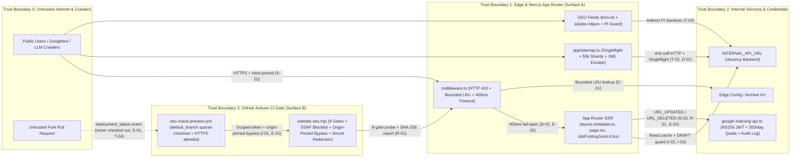

# Automated STRIDE Threat Model & Control Verification Report

> Auto-generated by `scripts/stride-audit.mjs` on `2026-11-21T14:27:14.330Z` from `reports/stride-matrix.json` (SHA-256: `15edf20e4947c2d6`).

## Executive Summary

- **Overall Security Gate Verdict:** **PASS (0 OPEN CRITICAL/HIGH)**
- **Total Mapped Threats:** `15` across all 6 STRIDE categories
- **CRITICAL / HIGH Threats:** `15/15` **MITIGATED** (`0` OPEN)
- **Linked Automated Test Suite:** `83` passed across `12` suites, `0` failed (exit code `0`)

### STRIDE Category Scoreboard

| Category | Total | MITIGATED | OPEN |
| :--- | :---: | :---: | :---: |
| **S** (Spoofing) | 3 | 3 | 0 |
| **T** (Tampering) | 4 | 4 | 0 |
| **R** (Repudiation) | 1 | 1 | 0 |
| **I** (Information Disclosure) | 3 | 3 | 0 |
| **D** (Denial of Service) | 2 | 2 | 0 |
| **E** (Elevation of Privilege) | 2 | 2 | 0 |

---

## System Architecture & Trust Boundaries

### Mermaid Trust-Boundary Diagram



### ASCII Trust-Boundary Diagram

```text
+-------------------------------------------------------------------------+
| [TB0] UNTRUSTED INTERNET / CRAWLERS / FORK PRs                          |
|  - Googlebot / LLM Crawlers / Malicious Partner HTML / Fork PR Payloads |
+---------------------------+-----------------------------+---------------+
                            |                             |
       HTTPS (Pinned Origin)|                             | deployment_status
                            v                             v
+----------------------------------------+  +-----------------------------+
| [TB1] NEXT.JS SEO/GEO SURFACE (A)      |  | [TB3] GITHUB ACTIONS CI (B) |
| - middleware.ts (410, LRU, 400ms)      |  | - seo-check-preview.yml     |
| - layout.metadata.ts (No root canon.)  |  |   (default_branch checkout, |
| - page.tsx + JobPostingJsonLd.tsx      |  |    zero ${{}} in run:)      |
| - sitemap.ts (Singleflight, 50k cap)   |  | - validate-seo.mjs          |
| - llms.txt + ai/jobs.ndjson (PI guard) |  |   (SSRF guard, origin-pin   |
+-------------------+--------------------+  |    bypass, secret masking)  |
                    |                       +-------------+---------------+
   Private Network  |                                     |
   (No Error Leaks) v                                     | 8-Gate Probe
+----------------------------------------+                |
| [TB2] INTERNAL DATA & GOOGLE APIs      |<---------------+
| - Edge Config / Archive KV             |
| - INTERNAL_API_URL (Vacancies)         |
| - Google Indexing API (RS256, 200/day) |
+----------------------------------------+
```

---

## STRIDE Threat & Control Traceability Matrix

| Threat ID | Category | Surface | Severity | Control Files | Static Checks | Test Verification | Status |
| :--- | :--- | :--- | :---: | :--- | :---: | :--- | :---: |
| `STRIDE-S-01` | S (Spoofing) | GitHub Actions CI | **CRITICAL** | `.github/workflows/seo-check-preview.yml` | 3/3 | `PASS` (1 test) | **MITIGATED** |
| `STRIDE-S-02` | S (Spoofing) | Next.js SEO/GEO | **HIGH** | `packages/nextjs-blueprint/lib/constants.ts, app/layout.metadata.ts, app/sitemap.ts, app/robots.ts` | 4/4 | `PASS` (1 test) | **MITIGATED** |
| `STRIDE-S-03` | S (Spoofing) | Google Indexing API | **HIGH** | `packages/nextjs-blueprint/lib/google-indexing-api.ts` | 2/2 | `PASS` (2 test) | **MITIGATED** |
| `STRIDE-T-01` | T (Tampering) | Next.js SEO/GEO | **CRITICAL** | `packages/nextjs-blueprint/lib/job-schema.ts, components/seo/JobPostingJsonLd.tsx, app/magang-nasional/lowongan/[slug]/page.tsx` | 3/3 | `PASS` (2 test) | **MITIGATED** |
| `STRIDE-T-02` | T (Tampering) | Next.js SEO/GEO | **HIGH** | `packages/nextjs-blueprint/app/sitemap.ts` | 2/2 | `PASS` (1 test) | **MITIGATED** |
| `STRIDE-T-03` | T (Tampering) | GEO / AI Feeds | **HIGH** | `packages/nextjs-blueprint/lib/prompt-injection-guard.ts, lib/llms.ts, app/llms.txt/route.ts, app/ai/jobs.ndjson/route.ts` | 4/4 | `PASS` (2 test) | **MITIGATED** |
| `STRIDE-T-04` | T (Tampering) | GitHub Actions CI | **CRITICAL** | `.github/workflows/seo-check-preview.yml, .github/workflows/seo-check-local.yml` | 2/2 | `PASS` (1 test) | **MITIGATED** |
| `STRIDE-R-01` | R (Repudiation) | Google Indexing API & CI Gate | **HIGH** | `packages/nextjs-blueprint/lib/google-indexing-api.ts, packages/seo-ci-gate/scripts/validate-seo.mjs` | 2/2 | `PASS` (1 test) | **MITIGATED** |
| `STRIDE-I-01` | I (Information Disclosure) | GitHub Actions CI & Validator | **CRITICAL** | `packages/seo-ci-gate/scripts/validate-seo.mjs, .github/workflows/seo-check-preview.yml` | 2/2 | `PASS` (2 test) | **MITIGATED** |
| `STRIDE-I-02` | I (Information Disclosure) | Next.js SEO/GEO | **HIGH** | `packages/nextjs-blueprint/lib/blog-loader.ts, lib/get-lowongan.ts, app/magang-nasional/lowongan/[slug]/page.tsx, app/sitemap.ts, app/ai/jobs.ndjson/route.ts` | 2/2 | `PASS` (2 test) | **MITIGATED** |
| `STRIDE-I-03` | I (Information Disclosure) | Next.js SEO/GEO | **HIGH** | `packages/nextjs-blueprint/lib/get-lowongan.ts, middleware.ts, lib/gone-page.ts` | 2/2 | `PASS` (1 test) | **MITIGATED** |
| `STRIDE-D-01` | D (Denial of Service) | Next.js SEO/GEO & CI Gate | **HIGH** | `packages/nextjs-blueprint/lib/job-schema.ts, app/sitemap.ts, middleware.ts, packages/seo-ci-gate/scripts/validate-seo.mjs` | 4/4 | `PASS` (2 test) | **MITIGATED** |
| `STRIDE-D-02` | D (Denial of Service) | Google Indexing API | **HIGH** | `packages/nextjs-blueprint/lib/google-indexing-api.ts` | 2/2 | `PASS` (2 test) | **MITIGATED** |
| `STRIDE-E-01` | E (Elevation of Privilege) | GitHub Actions CI & Validator | **CRITICAL** | `.github/workflows/seo-check-preview.yml, .github/workflows/seo-check-local.yml, packages/seo-ci-gate/scripts/validate-seo.mjs` | 2/2 | `PASS` (2 test) | **MITIGATED** |
| `STRIDE-E-02` | E (Elevation of Privilege) | Next.js SEO/GEO | **HIGH** | `packages/nextjs-blueprint/lib/job-lifecycle.ts, middleware.ts` | 2/2 | `PASS` (1 test) | **MITIGATED** |

## Detailed Control Verification Evidence

### STRIDE-S-01 (Spoofing | CRITICAL | GitHub Actions CI)
- **Threat:** Fork-PR spoofs validator script on deployment_status with bypass secrets in scope
- **Control Files:** `.github/workflows/seo-check-preview.yml`
- **Linked Test Evidence:** `tests/workflow-security.test.mjs :: hardens seo-check-preview.yml against Fork-PR Pwn Requests` -> **PASS**
- Static Check [PASS]: sparse-checkout pinned to default_branch (never deployment.sha)
- Static Check [PASS]: persist-credentials: false enforced on actions/checkout
- Static Check [PASS]: strict HTTPS target host allowlist (*.vercel.app / maganghub.kemnaker.go.id)
- **Status:** **MITIGATED**

### STRIDE-S-02 (Spoofing | HIGH | Next.js SEO/GEO)
- **Threat:** Host / X-Forwarded-Host header poisoning hijacks canonical URLs or sitemap <loc>
- **Control Files:** `packages/nextjs-blueprint/lib/constants.ts, app/layout.metadata.ts, app/sitemap.ts, app/robots.ts`
- **Linked Test Evidence:** `tests/stride-controls.test.mjs :: [STRIDE-S-02] pins canonical/sitemap origin` -> **PASS**
- Static Check [PASS]: resolvePinnedBaseUrl() pins canonical HTTPS allowlist in constants.ts
- Static Check [PASS]: Zero raw Host / X-Forwarded-Host header reads across metadata, sitemap, robots (comment-stripped)
- Static Check [PASS]: Blocker #0 guard: root metadata/rootMetadata omits alternates.canonical (scoped to root declaration)
- Static Check [PASS]: app/sitemap.ts and lib/llms.ts invoke resolvePinnedBaseUrl()
- **Status:** **MITIGATED**

### STRIDE-S-03 (Spoofing | HIGH | Google Indexing API)
- **Threat:** JWT claim tampering or forged OAuth2 service-account assertion
- **Control Files:** `packages/nextjs-blueprint/lib/google-indexing-api.ts`
- **Linked Test Evidence:** `tests/indexing-api.test.mjs & tests/stride-controls.test.mjs :: RS256 crypto.verify + [STRIDE-S-03]` -> **PASS**
- Static Check [PASS]: Strict iss/aud/exp/iat validation + HTTPS audience guard in buildServiceAccountJwt()
- Static Check [PASS]: RSA-SHA256 signing via Node built-in node:crypto only
- **Status:** **MITIGATED**

### STRIDE-T-01 (Tampering | CRITICAL | Next.js SEO/GEO)
- **Threat:** Stored XSS & </script> / U+2028 / U+2029 breakout via partner descriptionHtml in JSON-LD & SSR page
- **Control Files:** `packages/nextjs-blueprint/lib/job-schema.ts, components/seo/JobPostingJsonLd.tsx, app/magang-nasional/lowongan/[slug]/page.tsx`
- **Linked Test Evidence:** `tests/fuzz-parsers.test.mjs & tests/stride-controls.test.mjs :: 250 XSS fuzz + [STRIDE-T-01]` -> **PASS**
- Static Check [PASS]: Server-side allowlist HTML sanitizer strips scripts, event handlers & dangerous URIs
- Static Check [PASS]: serializeSafeJsonLd escapes <, >, &, U+2028, and U+2029 (job-schema.ts + lib/*seo*.ts)
- Static Check [PASS]: page.tsx sanitizes descriptionHtml before dangerouslySetInnerHTML
- **Status:** **MITIGATED**

### STRIDE-T-02 (Tampering | HIGH | Next.js SEO/GEO)
- **Threat:** XML / CDATA injection via untrusted vacancy slug in sitemap.ts
- **Control Files:** `packages/nextjs-blueprint/app/sitemap.ts`
- **Linked Test Evidence:** `tests/stride-controls.test.mjs :: [STRIDE-T-02] blocks XML/CDATA injection slugs` -> **PASS**
- Static Check [PASS]: escapeXml() escapes XML entities and strips XML 1.0 illegal control chars
- Static Check [PASS]: Strict isValidVacancySlug() allowlist filters records before emitting <loc>
- **Status:** **MITIGATED**

### STRIDE-T-03 (Tampering | HIGH | GEO / AI Feeds)
- **Threat:** Indirect Prompt Injection via partner vacancy descriptions/titles rendered to llms.txt & /ai/jobs.ndjson
- **Control Files:** `packages/nextjs-blueprint/lib/prompt-injection-guard.ts, lib/llms.ts, app/llms.txt/route.ts, app/ai/jobs.ndjson/route.ts`
- **Linked Test Evidence:** `tests/fuzz-parsers.test.mjs (150 PI fuzz) & tests/stride-controls.test.mjs :: [STRIDE-T-03]` -> **PASS**
- Static Check [PASS]: prompt-injection-guard.ts strips control/bidi/zero-width chars, caps field length & neutralizes delimiters/overrides
- Static Check [PASS]: llms.ts / app/llms.txt/route.ts sanitizes dynamic batch schedules
- Static Check [PASS]: app/ai/jobs.ndjson/route.ts sanitizes all partner fields & isolates strict single-line NDJSON
- Static Check [PASS]: GEO route handlers contain zero unfilled template placeholders (comment-stripped)
- **Status:** **MITIGATED**

### STRIDE-T-04 (Tampering | CRITICAL | GitHub Actions CI)
- **Threat:** GitHub Actions shell script injection via untrusted ${{ github.event.* }} inside run: blocks
- **Control Files:** `.github/workflows/seo-check-preview.yml, .github/workflows/seo-check-local.yml`
- **Linked Test Evidence:** `tests/workflow-security.test.mjs :: forbids ALL ${{ ... }} expression interpolation inside every run: block` -> **PASS**
- Static Check [PASS]: 0 ${{ ... }} expressions in any run: block in seo-check-preview.yml
- Static Check [PASS]: 0 ${{ ... }} expressions in any run: block in seo-check-local.yml
- **Status:** **MITIGATED**

### STRIDE-R-01 (Repudiation | HIGH | Google Indexing API & CI Gate)
- **Threat:** Missing structured audit trail & cryptographic digest for URL_DELETED/URL_UPDATED and CI gate failures
- **Control Files:** `packages/nextjs-blueprint/lib/google-indexing-api.ts, packages/seo-ci-gate/scripts/validate-seo.mjs`
- **Linked Test Evidence:** `tests/stride-controls.test.mjs :: [STRIDE-R-01] emits structured JSON audit logs & SHA-256 digests` -> **PASS**
- Static Check [PASS]: google-indexing-api.ts emits structured JSON IndexingAuditLogEntry with ISO timestamp + requestSha256
- Static Check [PASS]: validate-seo.mjs emits audit.{timestamp, deploymentSha, gateResults, reportSha256} without leaking secrets
- **Status:** **MITIGATED**

### STRIDE-I-01 (Information Disclosure | CRITICAL | GitHub Actions CI & Validator)
- **Threat:** VERCEL_AUTOMATION_BYPASS_SECRET exfiltration via cross-origin redirect or unmasked error logs
- **Control Files:** `packages/seo-ci-gate/scripts/validate-seo.mjs, .github/workflows/seo-check-preview.yml`
- **Linked Test Evidence:** `tests/e2e-http.test.mjs (0 bypass leakage) & tests/stride-controls.test.mjs :: [STRIDE-I-01]` -> **PASS**
- Static Check [PASS]: fetchUrl() pins x-vercel-protection-bypass strictly to currentUrl.origin === pinnedOrigin
- Static Check [PASS]: redactSecrets() masks VERCEL_AUTOMATION_BYPASS_SECRET & Bearer tokens in JSON reports and stderr
- **Status:** **MITIGATED**

### STRIDE-I-02 (Information Disclosure | HIGH | Next.js SEO/GEO)
- **Threat:** Draft blog or DRAFT/INTERNAL vacancy metadata leak in generateMetadata(), sitemap.ts, or AI feeds
- **Control Files:** `packages/nextjs-blueprint/lib/blog-loader.ts, lib/get-lowongan.ts, app/magang-nasional/lowongan/[slug]/page.tsx, app/sitemap.ts, app/ai/jobs.ndjson/route.ts`
- **Linked Test Evidence:** `tests/nextjs-blueprint.test.mjs (React.cache symmetric draft) & tests/stride-controls.test.mjs :: [STRIDE-I-02]` -> **PASS**
- Static Check [PASS]: blog-loader.ts enforces symmetric isBlogPostPubliclyVisible() inside React.cache() loader
- Static Check [PASS]: get-lowongan.ts, page.tsx, sitemap.ts & jobs.ndjson block DRAFT/INTERNAL symmetrically
- **Status:** **MITIGATED**

### STRIDE-I-03 (Information Disclosure | HIGH | Next.js SEO/GEO)
- **Threat:** INTERNAL_API_URL or stack trace disclosure on HTTP 410 or 500 error responses
- **Control Files:** `packages/nextjs-blueprint/lib/get-lowongan.ts, middleware.ts, lib/gone-page.ts`
- **Linked Test Evidence:** `tests/stride-controls.test.mjs :: [STRIDE-I-03] never leaks INTERNAL_API_URL or stack traces` -> **PASS**
- Static Check [PASS]: get-lowongan.ts throws generic error without interpolating raw upstream error/INTERNAL_API_URL
- Static Check [PASS]: middleware.ts & gone-page.ts return generic 410 responses with HTML-escaped slug and zero stack traces
- **Status:** **MITIGATED**

### STRIDE-D-01 (Denial of Service | HIGH | Next.js SEO/GEO & CI Gate)
- **Threat:** ReDoS in HTML/XML/slug parsers, sitemap thundering herd, or middleware cache-busting OOM flood
- **Control Files:** `packages/nextjs-blueprint/lib/job-schema.ts, app/sitemap.ts, middleware.ts, packages/seo-ci-gate/scripts/validate-seo.mjs`
- **Linked Test Evidence:** `tests/fuzz-parsers.test.mjs (50KB <15ms), tests/stride-controls.test.mjs ([STRIDE-D-01]) & reports/perf-stress-report.json` -> **PASS**
- Static Check [PASS]: Linear-time O(N) HTML/XML scanners in job-schema.ts and validate-seo.mjs
- Static Check [PASS]: middleware.ts enforces bounded MAX_EDGE_CACHE_ENTRIES LRU cap & 400ms AbortSignal.timeout
- Static Check [PASS]: sitemap.ts enforces 50,000 URL/shard cap & singleflight coalescing
- Static Check [PASS]: Phase 2.6 perf-stress-report.json passed all Hard SLA gates (p99 < 50ms, 0% error)
- **Status:** **MITIGATED**

### STRIDE-D-02 (Denial of Service | HIGH | Google Indexing API)
- **Threat:** Google Indexing API daily quota exhaustion (200/day) via bulk updates or webhook retry storms
- **Control Files:** `packages/nextjs-blueprint/lib/google-indexing-api.ts`
- **Linked Test Evidence:** `tests/indexing-api.test.mjs :: daily quota limit, dedup & idempotency TTL` -> **PASS**
- Static Check [PASS]: Default 200 req/day quota cap + URL deduplication + skippedQuota partition
- Static Check [PASS]: TTL idempotency cache suppresses duplicate webhook pings
- **Status:** **MITIGATED**

### STRIDE-E-01 (Elevation of Privilege | CRITICAL | GitHub Actions CI & Validator)
- **Threat:** Over-privileged GITHUB_TOKEN or SSRF to 169.254.169.254 / RFC1918 / obfuscated IP literals
- **Control Files:** `.github/workflows/seo-check-preview.yml, .github/workflows/seo-check-local.yml, packages/seo-ci-gate/scripts/validate-seo.mjs`
- **Linked Test Evidence:** `tests/workflow-security.test.mjs & tests/fuzz-parsers.test.mjs (250 SSRF vectors)` -> **PASS**
- Static Check [PASS]: Minimal scoped permissions in both GitHub Actions workflows
- Static Check [PASS]: validate-seo.mjs blocks RFC1918, 192.0.0/24, 198.18/15, .local, userinfo, cloud metadata, IPv4-mapped/translated & NAT64
- **Status:** **MITIGATED**

### STRIDE-E-02 (Elevation of Privilege | HIGH | Next.js SEO/GEO)
- **Threat:** Path traversal or hub route collision (../dashboard, %2e%2e, /kota/jakarta) in extractJobDetailSlug
- **Control Files:** `packages/nextjs-blueprint/lib/job-lifecycle.ts, middleware.ts`
- **Linked Test Evidence:** `tests/stride-controls.test.mjs :: [STRIDE-E-02] enforces strict [a-z0-9-]+ allowlist` -> **PASS**
- Static Check [PASS]: Strict [a-z0-9-]+ allowlist regex (STRICT_SLUG_RE) applied after safe decodeURIComponent
- Static Check [PASS]: middleware.ts delegates slug extraction to extractJobDetailSlug() before Edge KV lookup
- **Status:** **MITIGATED**

